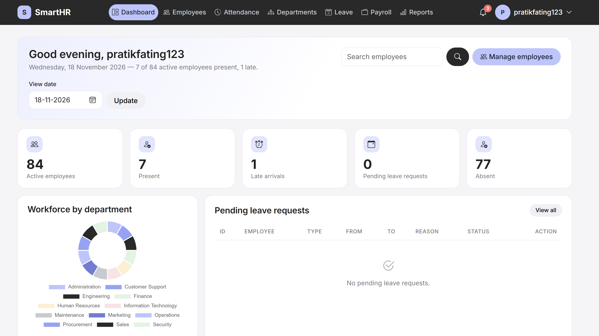
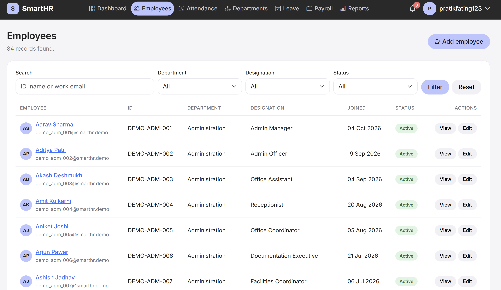
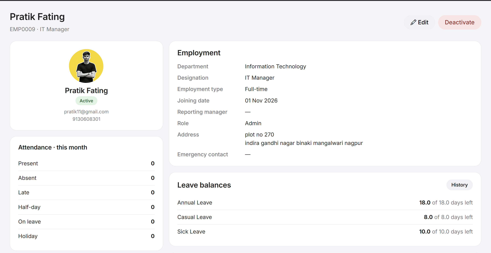
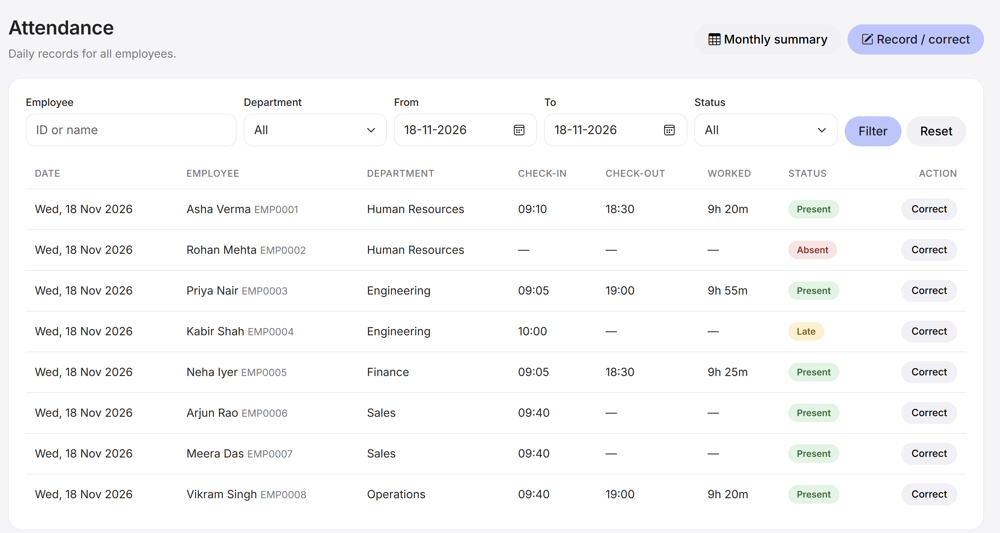
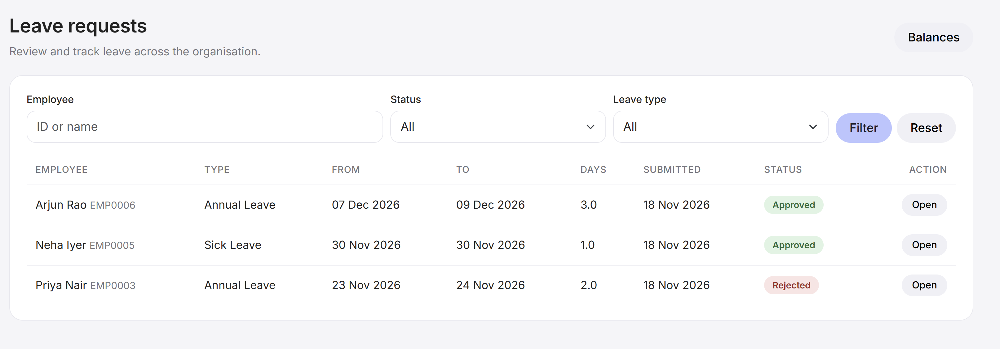
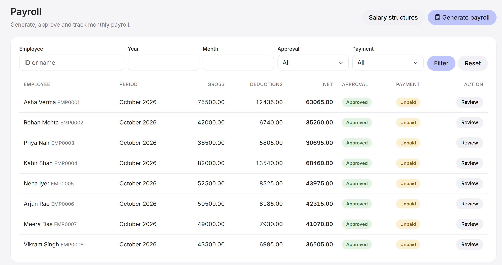
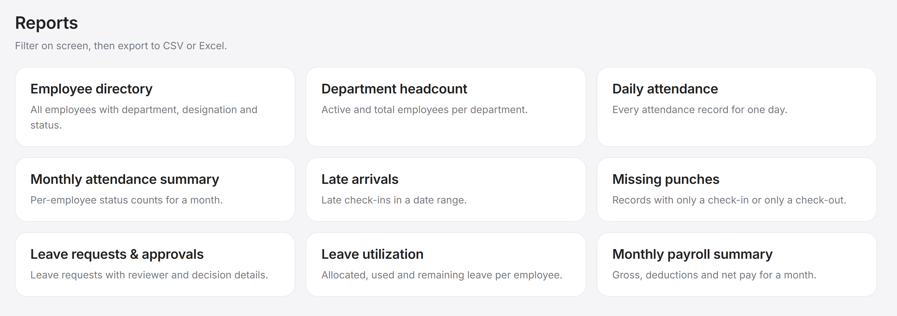

# SmartHR | Smart HR & Employee Management System

A role-based Human Resource Management System built with **Django 5.2** and **PostgreSQL**. SmartHR brings employee records, departments, attendance, leave management, payroll, reports, notifications, and audit logging into one web application.

> **Project note:** This README describes the code found in the uploaded project archive. The archive contains Django migration files, automated tests, and a sample employee profile image, but it does not contain application UI screenshots. Add your own screenshots to the `screenshots/` folder using the filenames shown below. Do not use sample or generated UI artwork as a screenshot of the running application.

---

## Contents

- [Overview](#overview)
- [Features](#features)
- [User roles and permissions](#user-roles-and-permissions)
- [Technology stack](#technology-stack)
- [Application screenshots](#application-screenshots)
- [Project structure](#project-structure)
- [Getting started](#getting-started)
- [Environment configuration](#environment-configuration)
- [Demo data](#demo-data)
- [Business rules and limitations](#business-rules-and-limitations)
- [Tests and validation](#tests-and-validation)
- [Security notes](#security-notes)
- [Future improvements](#future-improvements)

## Overview

SmartHR is designed to support common HR operations for a small or medium-sized organization. It uses a custom Django user model and role-based access checks. HR and administrative workflows are separated from employee self-service pages.

The application includes separate dashboards for HR/Admin users and employees. Reports can be filtered and exported to CSV or Excel.

## Features

### Employee management
- Create, view, and update employee records.
- Assign employee IDs, departments, designations, joining dates, employment types, and reporting managers.
- Store employee profile photos.
- Search, filter, and paginate employee records.
- Change employee status instead of deleting employee records.

### Department and designation management
- Create and manage departments.
- Create and manage designations.
- Assign department heads.
- View employee counts by department.

### Attendance management
- Record and correct daily attendance.
- Support Present, Absent, Late, Half-day, On leave, and Holiday statuses.
- Employee self check-in and check-out, when enabled.
- Monthly attendance summaries.
- Identify late arrivals, early arrivals, and missing punches.
- Prevent duplicate attendance records for the same employee and date.

### Leave management
- Submit leave requests.
- Review, approve, reject, or cancel requests according to role permissions.
- Track allocated, used, and remaining leave balances.
- Validate date ranges, overlapping requests, working days, and available balances.
- Restore leave balance when an approved request is cancelled.

### Payroll management
- Configure employee salary structures.
- Generate monthly payroll records.
- Review and approve generated payroll.
- Track payment status, including Unpaid, Paid, and On hold.
- View printable payslips using the browser's print function.

**Important:** Payroll calculations are sample calculations for this project. They are not a statutory payroll or tax-compliance engine. See [Business rules and limitations](#business-rules-and-limitations).

### Reports and exports
The report module defines nine report types:
1. Employee directory
2. Department headcount
3. Daily attendance
4. Monthly attendance summary
5. Late arrivals
6. Missing punches
7. Leave requests and approvals
8. Leave utilization
9. Monthly payroll summary

Reports support relevant filters and CSV/Excel exports, subject to the user's permissions.

### Dashboards, notifications, and audit logs
- HR/Admin dashboard with workforce and operational summaries.
- Employee dashboard with employee-specific information.
- In-app notifications and read/unread state.
- Audit log for important HR operations, including employee changes, attendance corrections, leave decisions, payroll actions, and department changes.

## User roles and permissions

| Capability | Admin | HR Manager | Employee |
|---|---:|---:|---:|
| Manage employees and departments | Yes | Yes, with restrictions on admin accounts and role changes | Own profile only |
| View and correct attendance | Yes | Yes | Own attendance, including self check-in/out when enabled |
| Review leave requests | Yes | Yes, excluding own request | Apply for and manage own requests |
| Manage salary structures and payroll | Yes | Only when an Admin grants payroll permission | No |
| View payslips | Yes | According to payroll permission | Own approved payslips |
| View reports | Yes | Yes, payroll reports require payroll permission | No |
| View audit log | Yes | No | No |

Permissions are checked in server-side views and querysets. Hiding a navigation link is not the only access control.

## Technology stack

| Layer | Technologies |
|---|---|
| Backend | Python 3.12+, Django 5.2 |
| Database | PostgreSQL |
| Optional local smoke-test database | SQLite |
| Frontend | Django Templates, HTML, CSS, JavaScript |
| UI framework | Bootstrap 5.3, Bootstrap Icons |
| Charts | Chart.js 4 |
| Spreadsheet exports | openpyxl |
| Environment configuration | python-dotenv |
| Image handling | Pillow |
| Fonts and CDN assets | Inter / Bootstrap / Chart.js assets loaded from external CDNs |

## Application screenshots

Place genuine screenshots captured from your running SmartHR application in a folder named `screenshots` at the project root.

Recommended screenshots:

| Screenshot | Filename |
|---|---|
| HR/Admin dashboard | `screenshots/dashboard.png` |
| Employee directory | `screenshots/employees.png` |
| Employee profile/details | `screenshots/employee-details.png` |
| Attendance list or summary | `screenshots/attendance.png` |
| Leave requests and approvals | `screenshots/leaves.png` |
| Payroll list or payslip | `screenshots/payroll.png` |
| Reports page | `screenshots/reports.png` |

When you add the image files, uncomment or add the corresponding Markdown image links below. GitHub will render them on this page.

## Application Screenshots

### HR/Admin Dashboard


### Employee Directory


### Employee Details


### Attendance


### Leave Management


### Payroll


### Reports


**Screenshot tip:** Use `Win + Shift + S` on Windows to capture the running application. Avoid including real employee personal information, email addresses, phone numbers, salary data, passwords, or other confidential information. Use fictional demo records where possible.

## Project structure

```text
smarthr/
├── accounts/          # Custom user model, login, profile, password change
├── core/              # Dashboard, permissions, audit log, shared utilities
│   └── management/
│       └── commands/  # Demo data and development admin commands
├── departments/       # Departments and designations
├── employees/         # Employee records and profile information
├── attendance/        # Attendance records and self check-in/out
├── leaves/            # Leave requests, balances, approval workflows
├── payroll/           # Salary structures, payroll, payslips
├── reports/           # Report builders and CSV/Excel exports
├── notifications/     # In-app notifications
├── config/            # Django settings and root URL configuration
├── templates/         # Django HTML templates
├── static/
│   ├── css/
│   └── js/
├── tests/             # Automated test suite
├── media/             # Uploaded media (not committed)
├── manage.py
├── requirements.txt
├── .env.example
├── .gitignore
└── README.md
```

## Getting started

### Prerequisites

Install the following before setup:

- Python 3.12 or newer
- PostgreSQL
- Git (optional, for cloning and version control)
- A modern web browser

### 1. Get the project

If you have cloned the repository:

```powershell
git clone https://github.com/YOUR_USERNAME/YOUR_REPOSITORY.git
cd YOUR_REPOSITORY
```

If you downloaded the ZIP, extract it and open the inner `smarthr` folder, the folder containing `manage.py`.

### 2. Create and activate a virtual environment

Windows PowerShell:

```powershell
py -3.12 -m venv .venv
.\.venv\Scripts\Activate.ps1
```

If PowerShell blocks activation, run:

```powershell
Set-ExecutionPolicy -Scope Process -ExecutionPolicy RemoteSigned
.\.venv\Scripts\Activate.ps1
```

### 3. Install dependencies

```powershell
python -m pip install --upgrade pip
pip install -r requirements.txt
```

### 4. Configure environment variables

Create your local environment file:

```powershell
Copy-Item .env.example .env
```

Open `.env` and set a unique Django secret key and your PostgreSQL credentials. Generate a key with:

```powershell
python -c "import secrets; print(secrets.token_urlsafe(50))"
```

Do not commit `.env` to GitHub.

### 5. Create the PostgreSQL database

Open PostgreSQL's SQL shell (`psql`) as a PostgreSQL administrator and run:

```sql
CREATE USER smarthr_user WITH PASSWORD 'replace-with-a-strong-password' CREATEDB;
CREATE DATABASE smarthr OWNER smarthr_user;
```

Use the same database name, username, password, host, and port in `.env`.

`CREATEDB` is useful when running Django's test suite because Django creates a temporary test database.

### 6. Apply database migrations

Migration files are included in this project. Apply them with:

```powershell
python manage.py migrate
```

You do not need to run `makemigrations` for the initial setup unless you have changed models.

### 7. Create an administrator

```powershell
python manage.py createsuperuser
```

The custom user model assigns the Admin role to a superuser.

### 8. Run the application

```powershell
python manage.py check
python manage.py runserver
```

Open:

- Application: http://127.0.0.1:8000/
- Django admin: http://127.0.0.1:8000/django-admin/

Sign in using the administrator account you created.

## Environment configuration

The `.env.example` file documents these settings:

| Variable | Purpose |
|---|---|
| `DJANGO_SECRET_KEY` | Django signing and security key |
| `DJANGO_DEBUG` | Enables/disables Django debug mode |
| `DJANGO_ALLOWED_HOSTS` | Allowed hostnames |
| `TIME_ZONE` | Application timezone, default `Asia/Kolkata` |
| `DB_ENGINE` | `postgres` by default; `sqlite` for a local smoke test |
| `DB_NAME` | PostgreSQL database name |
| `DB_USER` | PostgreSQL username |
| `DB_PASSWORD` | PostgreSQL password |
| `DB_HOST` / `DB_PORT` | PostgreSQL connection host and port |
| `WORK_START` / `WORK_END` | Configured workday start and end |
| `GRACE_MINUTES` | Late-arrival grace period |
| `EARLY_ARRIVAL_MINUTES` | Early-arrival threshold |
| `HALF_DAY_MIN_HOURS` | Minimum hours used for half-day classification |
| `WORKING_WEEKDAYS` | Working weekdays, Monday `0` through Sunday `6` |
| `ENABLE_SELF_CHECKIN` | Enables employee self check-in/out |
| `DJANGO_SECURE_SSL` | Enables secure cookie and SSL-related settings in production |
| `EMAIL_BACKEND` | Django email backend |
| `DEMO_PASSWORD` | Password used by the development demo-data command |

The project targets PostgreSQL. Set `DB_ENGINE=sqlite` only for a quick local smoke test. SQLite does not provide the same row-locking behavior as PostgreSQL.

## Demo data

A development-only management command is included:

```powershell
python manage.py seed_demo
```

The command requires `DJANGO_DEBUG=True` and a non-empty `DEMO_PASSWORD` in `.env`. It creates fictional Admin, HR Manager, and Employee accounts. The command is intended for development and should not be used as a production account setup process.

The project also includes a development admin command:

```powershell
python manage.py create_dev_admin
```

Configure the required `DEV_ADMIN_USERNAME`, `DEV_ADMIN_EMAIL`, and `DEV_ADMIN_PASSWORD` environment values before using that command.

## Business rules and limitations

### Attendance
- One attendance record is allowed per employee per date.
- Check-out must be later than check-in.
- Overnight shifts are not supported.
- Late arrival is determined using the configured work start and grace period.
- A short work duration can be classified as half-day using `HALF_DAY_MIN_HOURS`.
- Missing check-out for the current day is flagged only after the configured work end.
- The dashboard can count active employees without a qualifying attendance record as absent; the application does not automatically create absent records.

### Leave
- Leave requests use whole working days.
- Working weekdays are configured through `WORKING_WEEKDAYS`.
- Public holidays are represented by the `Holiday` model and can be managed through Django admin.
- A leave request must remain within one calendar year.
- Leave balance deductions are guarded to prevent duplicate deductions.
- Cancelling an approved request restores the deducted balance.

### Payroll
The sample payroll formula is:

```text
Gross Salary = Basic Salary + Allowances + Other Earnings
PF           = PF Percentage × Basic Salary
Tax          = Flat Tax Percentage × Gross Salary
Deductions   = PF + Tax + Other Deductions
Net Salary   = Gross Salary - Deductions
```

Calculations use decimal values and two-decimal rounding. Payroll rows store salary snapshots so later salary-structure changes do not rewrite historical payroll records.

This is **not a statutory payroll-compliance implementation**. Tax slabs, PF ceilings, insurance, proration, overtime, and loss-of-pay calculations are not included. The payslip is rendered for browser printing or Save as PDF; a server-side PDF generator is not included.

### Reports and exports
CSV and Excel exports are implemented. Export values beginning with formula-triggering characters are escaped to reduce spreadsheet formula-injection risk.

### Email
The included default email backend writes messages to the console. Email notifications and password-reset-by-email workflows are not implemented as a complete configured production service.

## Tests and validation

A Django test suite is included under `tests/`. Run:

```powershell
python manage.py test
```

Also run the Django configuration check:

```powershell
python manage.py check
```

The presence of test files does not by itself prove that the full suite passes in every environment. Run these commands locally after configuring the database and dependencies.

## Security notes

- Never commit `.env`, database credentials, secret keys, or real employee data.
- Keep `DJANGO_DEBUG=False` in production.
- Set a strong `DJANGO_SECRET_KEY` and a restrictive `DJANGO_ALLOWED_HOSTS`.
- Serve the application over HTTPS and configure secure cookies.
- Use PostgreSQL for deployment and back up the database.
- Protect employee photos and uploaded media. Django serves media from `MEDIA_ROOT` only while `DEBUG=True` in this configuration.
- Use fictional demo data for public screenshots and demonstrations.

The uploaded archive included a local `.env` file. The repository `.gitignore` excludes it, but verify that `.env` is not staged before pushing to GitHub. If it was already committed, remove it from Git tracking and rotate any credentials it contained.

## Future improvements

Potential extensions include:

- Email delivery and password reset workflows.
- Statutory payroll rules and configurable tax calculations.
- Server-generated PDF payslips.
- Holiday calendar management in the application UI.
- Bulk payroll approval and employee salary-history views.
- Deployment configuration using Docker and a production web server.
- More dashboard analytics and automated test coverage.

## License

No license file was present in the supplied project archive. Add a `LICENSE` file if you want to publish this project with explicit reuse permissions.

---

**Built with Django and PostgreSQL.**
